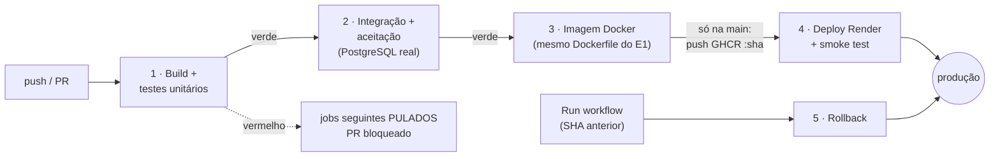

# AgendaSaúde — agendamento de consultas


API REST para clínicas agendarem consultas sem conflito de horário, respeitando o expediente e a
política de cancelamento. É o Projeto Integrador do grupo para o **Desafio do PI: Container, TDD e
Deploy automatizados** (Infraestrutura de Software · CESAR School · 2026.2).

| | |
|---|---|
| **Repositório** | `https://github.com/SEU-USUARIO/agendasaude` |
| **URL pública** | `https://agendasaude-xxxx.onrender.com` (`/api/versao` mostra o commit no ar) |
| **Stack** | Java 21 · Spring Boot 4.0 · PostgreSQL 17 · Flyway · JUnit 6 · Mockito · Testcontainers |
| **Esteira** | GitHub Actions → GitHub Container Registry → Render |

**A pergunta central do desafio:** *se um colega clonar o repositório amanhã, ele consegue rodar,
testar e publicar o sistema sem pedir ajuda?* As seções abaixo respondem cada parte.

---

## Integrantes

| Nome | Matrícula | GitHub | Papel principal |
|---|---|---|---|
| _Nome 1_ | _000000_ | `@usuario1` | E1 · Containers |
| _Nome 2_ | _000000_ | `@usuario2` | E2 · Regras de negócio e testes unitários |
| _Nome 3_ | _000000_ | `@usuario3` | E2 · Integração e aceitação |
| _Nome 4_ | _000000_ | `@usuario4` | E3 · Esteira, deploy e rollback |

---

## Como rodar

### Do zero, com Docker (o jeito oficial)

Pré-requisito: Docker com Compose v2 (Docker Desktop ou Docker Engine).

```bash
git clone https://github.com/SEU-USUARIO/agendasaude.git
cd agendasaude
cp .env.example .env              # configuração local, fora do Git (troque a senha se quiser)
docker compose up -d --build      # compila, roda os testes unitários, gera a imagem e sobe API + banco
```

Em cerca de 1 minuto:

```bash
docker compose ps                 # api e banco com STATUS (healthy)
curl http://localhost:8080/       # página inicial com a lista de endpoints
```

| Comando | Efeito |
|---|---|
| `docker compose logs -f api` | acompanha os logs da API |
| `docker compose exec banco psql -U agendasaude agendasaude` | abre o banco |
| `docker compose down` | para tudo; **os dados ficam** no volume `dados-postgres` |
| `docker compose down -v` | para tudo e **apaga os dados** |

### Usando a API

```bash
# Agendar (médico 1, paciente 1, terça às 09:00 — use uma data futura, em dia útil)
curl -i -X POST localhost:8080/api/consultas -H 'Content-Type: application/json' \
     -d '{"medicoId": 1, "pacienteId": 1, "inicio": "2026-11-03T09:00:00"}'

# Agenda do dia do médico 1
curl 'localhost:8080/api/medicos/1/agenda?data=2026-11-03'

# Cancelar a consulta 1 (exige 24 h de antecedência)
curl -i -X PATCH localhost:8080/api/consultas/1/cancelamento
```

| Método | Rota | Respostas |
|---|---|---|
| `GET` | `/api/medicos` · `/api/pacientes` | 200 |
| `POST` | `/api/medicos` · `/api/pacientes` | 201 · 400 inválido · 409 CRM/e-mail repetido |
| `POST` | `/api/consultas` | 201 · 400 · 404 · **409** `MEDICO_OCUPADO`/`PACIENTE_OCUPADO` · **422** `FORA_DO_EXPEDIENTE`/`HORARIO_NAO_ALINHADO`/`HORARIO_NO_PASSADO`/`ALEM_DA_JANELA` |
| `GET` | `/api/consultas/{id}` | 200 · 404 |
| `PATCH` | `/api/consultas/{id}/cancelamento` | 200 · 404 · 409 `CONSULTA_JA_CANCELADA` · 422 `CANCELAMENTO_TARDIO` |
| `GET` | `/api/medicos/{id}/agenda?data=AAAA-MM-DD` | 200 (ordenada, sem canceladas) · 404 |
| `GET` | `/api/versao` · `/actuator/health` | 200 |

Erros seguem o padrão **Problem Details (RFC 9457)**, com o campo `codigo` estável:

```json
{ "status": 409, "title": "Regra de negócio violada",
  "detail": "O médico já tem uma consulta neste horário.", "codigo": "MEDICO_OCUPADO" }
```

### Sem Docker (para desenvolver)

Java 21 e Maven 3.9. Os testes `*IT` precisam de Docker rodando (Testcontainers).

```bash
mvn test       # só unitários (segundos, sem Docker)
mvn verify     # unitários + integração + aceitação
```

---

## Testes

### Do story map ao teste

O [story map](docs/story-map.md) define o backbone e a Release 1. As **3 histórias** da Release 1 foram
quebradas em **12 tarefas**, e cada tarefa tem o teste que diz quando ela acabou:

| História | Tarefas de regra → unitário | Integração (PostgreSQL real) | Aceitação (HTTP, Dado/Quando/Então) |
|---|---|---|---|
| **H1** Agendar em horário livre | T1 `ExpedienteTest` · T2 `JanelaDeAgendamentoTest` · T3 `AgendamentoServiceTest` | T4 `ConsultaRepositoryIT` | T5 `AgendarConsultaAceitacaoIT` |
| **H2** Cancelar consulta | T6 `PoliticaDeCancelamentoTest` · T7 `AgendamentoServiceTest` | T8 `ConsultaRepositoryIT` | T9 `CancelarConsultaAceitacaoIT` |
| **H3** Ver agenda do dia | T11 `AgendamentoServiceTest` | T10 `ConsultaRepositoryIT` | T12 `AgendaDoDiaAceitacaoIT` |

### Testes por nível (pirâmide)

| Nível | Quantos | O que garante | Ferramentas | Onde roda |
|---|---|---|---|---|
| Unitário | 30 | cada regra, isolada, em milissegundos | JUnit 6, Mockito, `Clock` fixo | `mvn test`, `docker build` e job 1 da esteira |
| Integração | 5 | migrações, índices únicos parciais, consulta da agenda | Spring Boot Test + Testcontainers (`postgres:17-alpine`) | `mvn verify` e job 2 |
| Aceitação | 9 | os critérios de aceite de cada história, por HTTP | App inteira em porta aleatória + PostgreSQL + relógio congelado | `mvn verify` e job 2 |
| Smoke | 3 checagens | a versão certa subiu em produção e fala com o banco | `scripts/smoke-test.sh` | job 4, após cada deploy |

Os cenários de aceitação estão escritos em **Gherkin** no story map e implementados como testes JUnit
no formato Dado/Quando/Então (ver Decisões).

### Histórico red → green

Cada tarefa tem um commit `test: … (RED)` seguido de `feat: … (GREEN)`:

```bash
git log --oneline --reverse
```

A narrativa completa, incluindo o **bug da virada da meia-noite** que um teste de borda pegou no nosso
próprio GREEN, está em **[docs/jornada-tdd.md](docs/jornada-tdd.md)**. As saídas reais de cada passo estão
em [`docs/tdd-log/`](docs/tdd-log/).

### Quais regras ganharam teste primeiro, e por quê (risco)

| Prioridade | Regra | Por que primeiro |
|---|---|---|
| 1 | Conflito de horário (médico **e** paciente) + índice único no banco | É o problema central: dois pacientes no mesmo horário = atendimento atrasado ou perdido. Também é a única regra sujeita a **corrida** entre requisições, por isso tem teste unitário **e** de integração. |
| 2 | Expediente (dias, horário, almoço, grade de 30 min) | Consulta marcada com a clínica fechada = paciente na porta. Muitas bordas (onde nasceu o bug da meia-noite). |
| 3 | Cancelamento com 24 h | Horário ocioso sem tempo de recolocar outro paciente = perda de receita. Borda inclusiva (exatamente 24 h) decidida pelo teste. |
| 4 | Janela de 60 dias / sem passado | Risco menor, mas barato de testar. |
| 5 | Agenda do dia | Só leitura: o erro aparece e não corrompe dados. |

### O que ficou sem teste (e por quê)

- **Cadastros de médico e paciente:** CRUD sem regra de negócio, cobertos só indiretamente pelos testes de
  aceitação (que cadastram antes de agendar).
- **Concorrência sob carga real:** o teste de integração prova que o índice barra a duplicata, mas não
  simulamos centenas de requisições simultâneas.
- **Scripts da esteira** (`deploy-render.sh`, `smoke-test.sh`): validados manualmente contra um servidor
  falso e na própria esteira; não têm testes automatizados.
- **Fuso e horário de verão:** fixamos `America/Sao_Paulo` (sem horário de verão desde 2019); não há testes
  para clínicas em outros fusos.
- **Segurança/autenticação:** fora da Release 1 (está na Release 2 do story map).

---

## Pipeline e deploy



| Job | Quando roda | O que faz | Se falhar |
|---|---|---|---|
| **1 · Build e testes unitários** | todo push e PR | `mvn test` + resumo no *Summary* | jobs 2–4 pulados; PR não pode ser mergeado |
| **2 · Integração e aceitação** | depois do 1 | `mvn verify -DskipUTs=true` com Testcontainers | jobs 3–4 pulados |
| **3 · Imagem Docker** | depois do 2 | `docker build` com o Dockerfile do E1 (que roda os unitários de novo, no 1º estágio). **Na main**: publica `ghcr.io/…:<sha>` e `:latest` | nada é publicado |
| **4 · Deploy + smoke** | só merge na `main` | Deploy Hook do Render com a imagem `:<sha>`; espera `/api/versao` = `<sha>`, `/actuator/health` = UP e `/api/medicos` responder | a versão anterior continua no ar; o job avisa |
| **5 · Rollback** | manual (*Run workflow*) | republica a imagem de um SHA anterior (sem recompilar) + smoke | — |

Arquivo: [`.github/workflows/ci-cd.yml`](.github/workflows/ci-cd.yml) (validado com `actionlint`).

### Fluxo de branch: GitHub Flow, aplicado de verdade

1. `main` sempre publicável e **protegida** (ruleset): sem push direto, sem force-push, merge só por PR
   com **1 aprovação** e os **3 checks obrigatórios** verdes.
2. Cada tarefa em uma branch curta (`feature/t6-cancelamento`, `fix/meia-noite`), de horas a 2 dias.
3. Pull request com o [template](.github/pull_request_template.md): teste antes do código, uso de IA, revisão.
4. Merge na `main` → deploy automático.

### Deploy e segredos

| O quê | Onde fica | Quem vê |
|---|---|---|
| URL do Deploy Hook do Render | **GitHub Secrets** (`RENDER_DEPLOY_HOOK_URL`) | ninguém: o GitHub criptografa e mascara nos logs |
| Senha do banco de produção | **variáveis de ambiente do Render** | só quem administra o serviço |
| URL pública | GitHub **Variables** (`URL_PRODUCAO`) | todos (não é segredo) |
| Senha local | `.env` (no `.gitignore`) | só a sua máquina |
| `GITHUB_TOKEN` (push no GHCR) | gerado pelo GitHub a cada execução, com permissão `packages: write` só no job 3 | ninguém |

O passo a passo para configurar GitHub, GHCR, Render, segredos e a proteção da `main` está em
**[docs/configurar-github-e-render.md](docs/configurar-github-e-render.md)**.

### Como voltar à versão anterior (rollback)

1. **Esteira:** Actions → **CI/CD** → **Run workflow** → SHA do último commit bom → o job 5 republica a imagem
   `:<sha>` (imutável, já está no GHCR) e roda o smoke test.
2. **Painel do Render:** Deploys → deploy anterior → **Rollback**.
3. **Definitivo:** `git revert <sha>` → PR → merge, passando pelos mesmos gates.

### Evidências

Prints e links das execuções em **[docs/evidencias/](docs/evidencias/README.md)**:
execução **vermelha** que barrou o deploy (gerada com [`scripts/demo-esteira-vermelha.sh`](scripts/demo-esteira-vermelha.sh)),
execução **verde** que publicou, URL no ar e rollback.

---

## Decisões

Uma linha por decisão: o que escolhemos, as alternativas e o porquê.

| Decisão | Escolha | Alternativas consideradas | Por quê |
|---|---|---|---|
| Linguagem e framework | Java 21 + Spring Boot **4.0.8** | Spring Boot 3.5; Node/NestJS; Python/FastAPI | Java é a linguagem da disciplina (ola-java, Rota Vital). A linha 3.5 saiu do suporte open source em 30/06/2026; projeto novo começa numa versão com correções de segurança. Java 21 é LTS. |
| Imagem de build (1º estágio) | `maven:3.9-eclipse-temurin-21` | instalar Maven numa imagem JDK; Maven Wrapper | Imagem oficial com JDK e Maven prontos; descartada depois do build. |
| Imagem de runtime (2º estágio) | `eclipse-temurin:21-jre-alpine` | `eclipse-temurin:21-jre` (Ubuntu); distroless | **JRE** (sem compilador) sobre **Alpine**: imagem bem menor e com menos pacotes, ou seja, menos superfície de vulnerabilidades. Tem `wget` para o healthcheck. Distroless seria ainda menor, mas sem shell para depurar na aula. |
| Multi-stage | Sim: 1º compila e testa; 2º leva só o `.jar` | um estágio só; jar construído fora do Docker | Maven, código-fonte e JDK não vão para produção. Teste vermelho = `docker build` falha = **não existe imagem** com erro. O build é igual em qualquer máquina. |
| Usuário no container | `app` (não root) | root (padrão) | Se a aplicação for comprometida, o invasor não é root dentro do container. |
| Banco | PostgreSQL **17** (`postgres:17-alpine`) | MySQL; MongoDB; PostgreSQL 18 | Relacional (consultas, médicos e pacientes se relacionam), com **índice único parcial** e `CHECK`. Versão 17: o Postgres gratuito do Render aceita 17, e a imagem 18 mudou o caminho padrão dos dados. Mesma versão no compose, nos testes e na produção. |
| Dados | **Volume nomeado** `dados-postgres` | bind mount (`./data`); sem volume | Sobrevive ao `docker compose down`; gerenciado pelo Docker, sem problemas de permissão entre Windows, macOS e Linux. |
| Rede entre serviços | Rede padrão do Compose; API acha o banco pelo nome `banco` | `localhost`; IP fixo; `network_mode: host` | Dentro de um container, `localhost` é o próprio container. O Compose dá DNS por nome de serviço. O banco **não publica porta** no PC. |
| Ordem de subida | `depends_on: condition: service_healthy` + healthcheck `pg_isready` | `depends_on` simples; retry na aplicação | Sem isso a API sobe antes do banco aceitar conexões e o Flyway falha. |
| Esquema do banco | **Flyway** (migrações versionadas) + `ddl-auto=validate` | `ddl-auto=update` do Hibernate | Esquema versionado no Git, igual em todos os ambientes; o Hibernate só confere, nunca altera tabelas em produção. |
| Configuração | Variáveis de ambiente (`DB_*`, `PORT`, `APP_VERSION`) com padrões de dev no `application.yml`; `.env.example` versionado | perfis Spring com senha no YAML | 12-Factor: o mesmo artefato roda em qualquer ambiente; nenhum segredo no repositório; o compose **recusa subir** sem `POSTGRES_PASSWORD`. |
| Qual regra testar primeiro | Conflito de horário e expediente | pela ordem do story map | Maior risco para o paciente (ver tabela de risco em Testes). |
| Testes de integração | **Testcontainers** com a mesma imagem do compose | H2 em memória; banco compartilhado | H2 não reproduz o índice parcial do PostgreSQL. Um container descartável por execução isola os testes e funciona no runner do GitHub. |
| Testes de aceitação | JUnit no formato Dado/Quando/Então + Gherkin como especificação | Cucumber executando os `.feature` | A versão estável do Cucumber ainda não suporta oficialmente o JUnit 6 do Spring Boot 4; o PDF permite Gherkin como opção. Os cenários estão no story map. |
| Tempo nos testes | `Clock` injetável; relógio fixo nos testes | `LocalDateTime.now()` direto | Regras de "24 h" e "60 dias" teriam testes que mudam de resultado conforme a hora. |
| Concorrência | Checagem no serviço **e** índice único parcial no banco | só checagem no código; lock pessimista | A checagem dá mensagem amigável; o índice é a garantia contra corrida. Parcial (`WHERE status='AGENDADA'`): cancelar libera o horário. |
| CI/CD | **GitHub Actions** | GitLab CI; Jenkins; Azure Pipelines | O código já está no GitHub; runners gratuitos com Docker (necessário ao Testcontainers); segredos e ambientes integrados; foi a ferramenta da aula. |
| Fluxo de branch | **GitHub Flow** | Git Flow; GitLab Flow | Grupo pequeno, **uma versão no ar** e deploy a cada merge. Git Flow (develop/release/hotfix) serve para versões planejadas e várias versões em uso. GitLab Flow pede um ambiente de homologação que o plano gratuito não comporta. |
| Registry | **GitHub Container Registry** (GHCR) | Docker Hub | Autenticação com o `GITHUB_TOKEN` da própria execução (sem senha extra); imagem ligada ao repositório. |
| Tag da imagem | **SHA do commit** (+ `latest`) | só `latest`; versão semântica | O SHA é imutável e rastreável: o que está no ar = o commit que passou nos testes (o smoke test confere). O rollback é só republicar um SHA antigo. |
| Provedor de deploy | **Render**, serviço por imagem + Deploy Hook | Railway; Fly.io; Render compilando do repositório | Plano gratuito com HTTPS e PostgreSQL gerenciado. **Deploy por imagem**: o Render roda exatamente a imagem testada pela esteira, sem recompilar. O Deploy Hook deixa a esteira decidir quando publicar (só com tudo verde). Fly.io exige cartão; o Railway gratuito é por crédito. |
| Segredos | Deploy Hook no **GitHub Secrets**; senha do banco nas **variáveis do Render**; `.env` no `.gitignore` | segredos no YAML ou no `application.yml` | Cada segredo fica no cofre de quem precisa dele e nunca no Git. |
| Verificação pós-deploy | Smoke test compara `/api/versao` com o SHA | só checar HTTP 200 | Um 200 pode vir da versão antiga ainda no ar; comparar o SHA prova que a nova versão subiu. |
| Rollback | Job manual que republica um SHA + Rollback do Render + `git revert` | rebuild de um commit antigo | Republicar uma imagem já testada é rápido e determinístico. |

Limitações conhecidas do plano gratuito do Render: o serviço "dorme" após 15 minutos sem acesso e leva
cerca de 1 minuto para acordar; o Postgres gratuito expira 30 dias após a criação
([render.com/docs/free](https://render.com/docs/free)).

---

## Uso de IA

**Permitido e declarado**, como pede o PDF: *a IA rascunha; o grupo valida e assina.*

**Ferramenta:** Claude (Anthropic), modelo Claude Opus 5.5, via claude.ai.

### Para que foi usada

| Parte | O que a IA fez | O que o grupo fez |
|---|---|---|
| Story map e histórias | Propôs o domínio, o backbone, as 3 histórias, os critérios Gherkin e a quebra em tarefas | _Revisar se reflete o PI real e ajustar_ |
| Testes e código (E2) | Escreveu os testes **antes** do código, os esqueletos e as implementações, ciclo a ciclo, com commits `test:` → `feat:` | _Rodar `mvn verify`, ler cada teste e perguntar "ele falharia se a regra quebrasse?"_ |
| Containers (E1) | Dockerfile multi-stage, `compose.yaml`, `.env.example` | _Subir do zero em pelo menos 2 máquinas diferentes_ |
| Esteira (E3) | `ci-cd.yml`, scripts de deploy, smoke test, rollback e o guia de configuração | _Configurar GitHub, GHCR e Render; gerar as evidências_ |
| Documentação | README, decisões, jornada TDD, roteiro da apresentação | _Revisar, corrigir e completar com a experiência do grupo_ |
| Pesquisa | Confirmou na web o fim de suporte do Spring Boot 3.5, a compatibilidade Cucumber × JUnit 6, os limites do plano gratuito, o Deploy Hook com `imgURL` e o rollback do Render | _Conferir as fontes listadas abaixo_ |

### Prompts principais

1. *"Com base no desafio [PDF do Desafio do PI + slides da aula anexados], faça tudo que o professor pede de
   maneira detalhada e compreensível, com informações ricas; pesquise ou crie fontes se for necessário."*
2. Respostas às perguntas de escopo feitas pela IA: *stack* **Java + Spring Boot**, código **do zero**, banco
   **PostgreSQL**, deploy no **Render**.
3. _Grupo: acrescentem aqui os prompts que usarem daqui em diante (ex.: "explique por que este teste falha", "revise este Dockerfile")._

### Como a IA foi verificada

- **O que a IA conseguiu executar no ambiente dela:** os 30 testes unitários a cada passo red/green
  ([docs/tdd-log](docs/tdd-log/)); as migrações SQL num PostgreSQL real (índices, CHECK e consulta da agenda);
  a compilação de todo o código; `docker compose config`; `actionlint` na esteira; os scripts de deploy e
  smoke test contra um servidor falso.
- **O que a IA não conseguiu executar** (o ambiente bloqueava o Maven Central e o Docker Hub): `mvn verify`
  com Spring e Testcontainers, `docker build` e a esteira no GitHub. **Isso foi validado pelo grupo** —
  ver checklist abaixo.
- Cuidado que o professor destacou: a IA também escreve teste fraco, que sempre passa. Por isso o script
  [`demo-esteira-vermelha.sh`](scripts/demo-esteira-vermelha.sh) quebra a regra de propósito e confirma que
  os testes ficam vermelhos.
- Todos os commits gerados com IA têm o trailer `Assisted-by: Claude (Anthropic)`.

### Checklist de validação do grupo (antes de entregar)

- [ ] `mvn verify` → `BUILD SUCCESS` em uma máquina do grupo
- [ ] `docker compose up -d --build` do zero em uma segunda máquina
- [ ] Esteira verde no GitHub, deploy no Render e URL respondendo
- [ ] Evidências em `docs/evidencias/` (inclusive a execução vermelha)
- [ ] Integrantes, URLs e `SEU-USUARIO` preenchidos neste README
- [ ] Cada integrante leu e consegue explicar a parte que vai apresentar

---

## Estrutura do repositório

```
├── .github/
│   ├── workflows/ci-cd.yml          # E3 · esteira completa
│   └── pull_request_template.md
├── docs/
│   ├── story-map.md                 # E2 · backbone, releases, histórias, Gherkin, tarefas
│   ├── jornada-tdd.md               # E2 · ciclos red → green e lições aprendidas
│   ├── tdd-log/                     # E2 · saída real dos testes em cada passo
│   ├── configurar-github-e-render.md# E3 · passo a passo de configuração
│   ├── evidencias/                  # prints exigidos (E1, E2, E3)
│   └── apresentacao.md              # roteiro da apresentação
├── scripts/                         # deploy, smoke test, resumo de testes, demo vermelha
├── src/main/java/br/com/agendasaude/
│   ├── dominio/                     # regras puras (sem Spring): Expediente, Janela, Política…
│   ├── agendamento/                 # Consulta, serviço, repositório, controller
│   ├── cadastro/                    # médicos e pacientes
│   ├── config/  web/                # relógio, tratamento de erros, /api/versao
├── src/main/resources/db/migration/ # Flyway V1 (estrutura) e V2 (dados iniciais)
├── src/test/java/…                  # *Test (unitários) e *IT (integração e aceitação)
├── Dockerfile  compose.yaml  .env.example  render.yaml
```

## Referências

- BECK, K. *Test-Driven Development: By Example*. Addison-Wesley, 2003.
- COHN, M. *Succeeding with Agile*. Addison-Wesley, 2009 (pirâmide de testes).
- FOWLER, M. *Continuous Integration*. martinfowler.com, 2006.
- HUMBLE, J.; FARLEY, D. *Continuous Delivery*. Addison-Wesley, 2010, cap. 5.
- NAGAPPAN, N. et al. Realizing quality improvement through test driven development. *Empirical Software Engineering*, v. 13, 2008.
- NORTH, D. Introducing BDD. *Better Software*, 2006.
- PATTON, J. *User Story Mapping*. O'Reilly, 2014.
- WIGGINS, A. *The Twelve-Factor App*. 12factor.net, 2011.
- CHACON, S. GitHub Flow. scottchacon.com, 2011.
- Docker Docs — [Multi-stage builds](https://docs.docker.com/build/building/multi-stage/) · [Compose file reference](https://docs.docker.com/reference/compose-file/).
- Spring — [Spring Boot 4.0 Migration Guide](https://github.com/spring-projects/spring-boot/wiki/Spring-Boot-4.0-Migration-Guide) · [Testcontainers no Spring Boot](https://docs.spring.io/spring-boot/reference/testing/testcontainers.html).
- Render — [Deploy Hooks](https://render.com/docs/deploy-hooks) · [Rollbacks](https://render.com/docs/rollbacks) · [Deploy for Free](https://render.com/docs/free) · [Blueprint spec](https://render.com/docs/blueprint-spec).
- GitHub Docs — [Understanding GitHub Actions](https://docs.github.com/actions) · [About rulesets](https://docs.github.com/repositories/configuring-branches-and-merges-in-your-repository/managing-rulesets/about-rulesets).
- Fim do suporte do Spring Boot 3.5: [HeroDevs](https://www.herodevs.com/blog-posts/spring-boot-3-5-is-officially-end-of-life-here-is-what-that-means-for-teams-still-running-it) · [endoflife](https://endoflife.ai/article-spring-june-30-eol-wave).
- Cucumber × JUnit 6 (ainda não lançado): [CHANGELOG do cucumber-jvm](https://github.com/cucumber/cucumber-jvm/blob/main/CHANGELOG.md).
